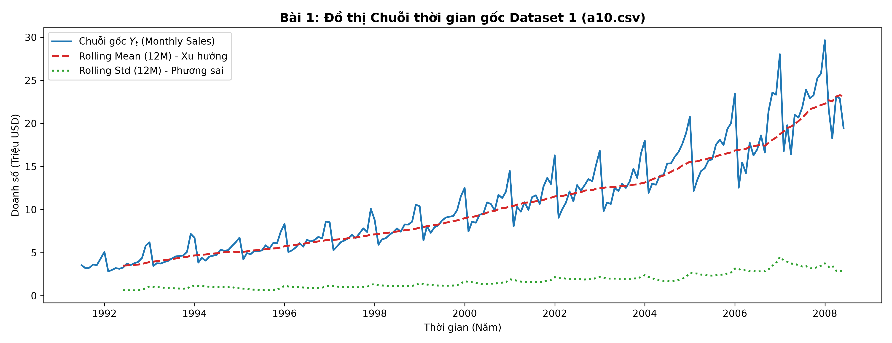
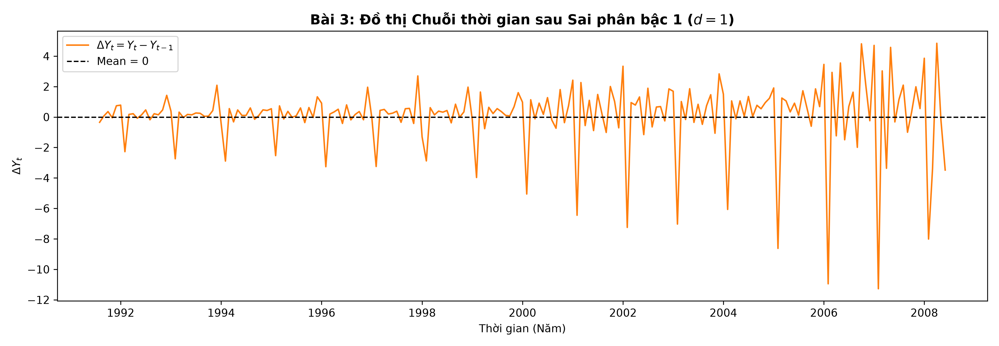
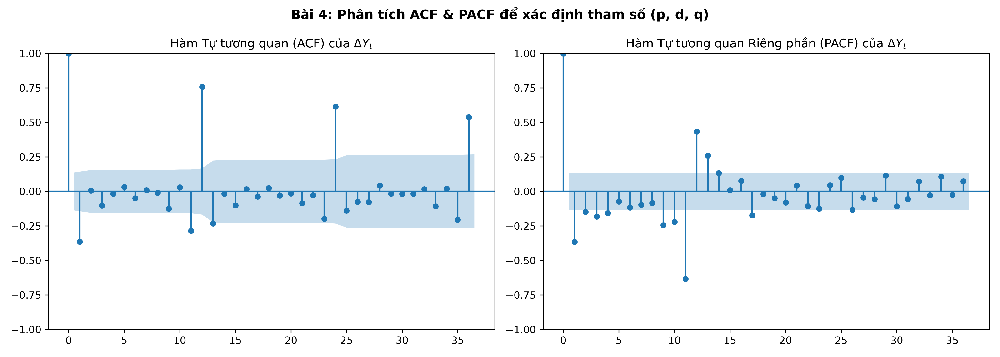
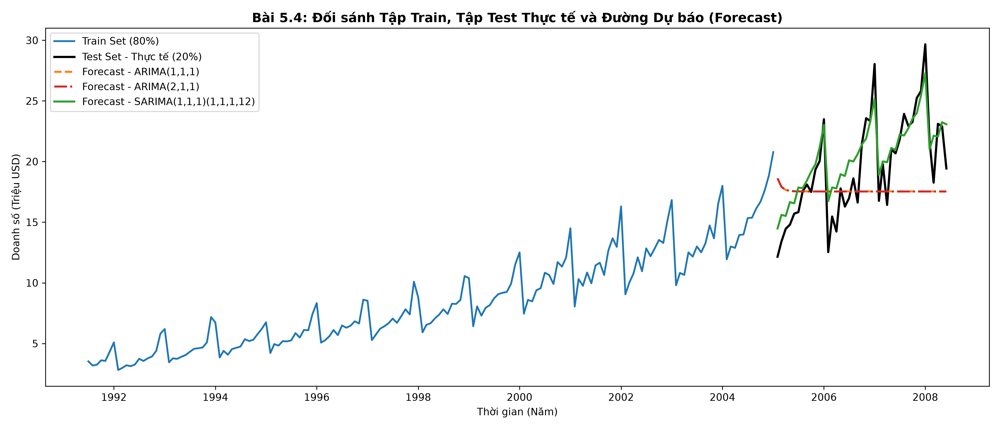
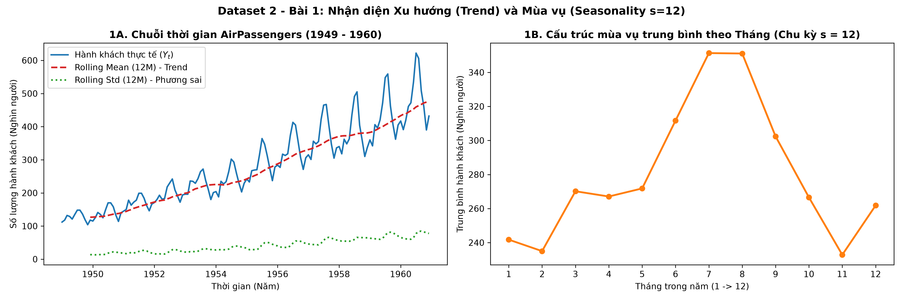
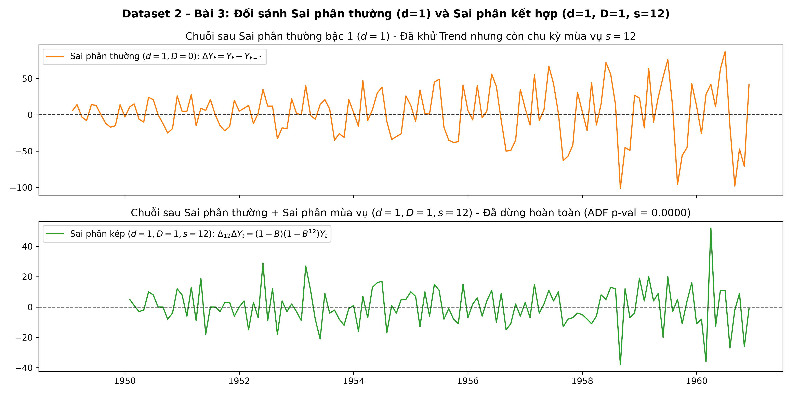
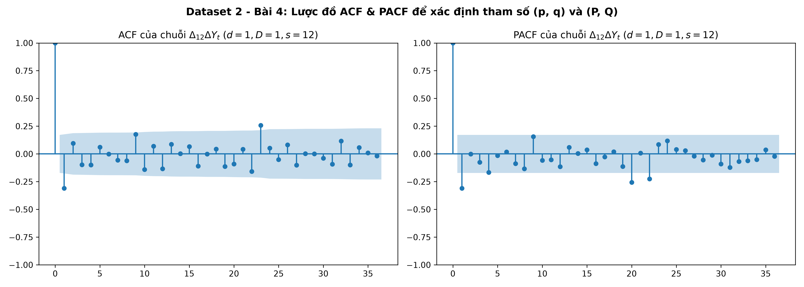
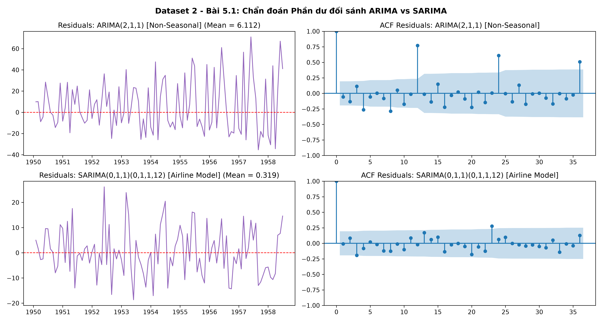
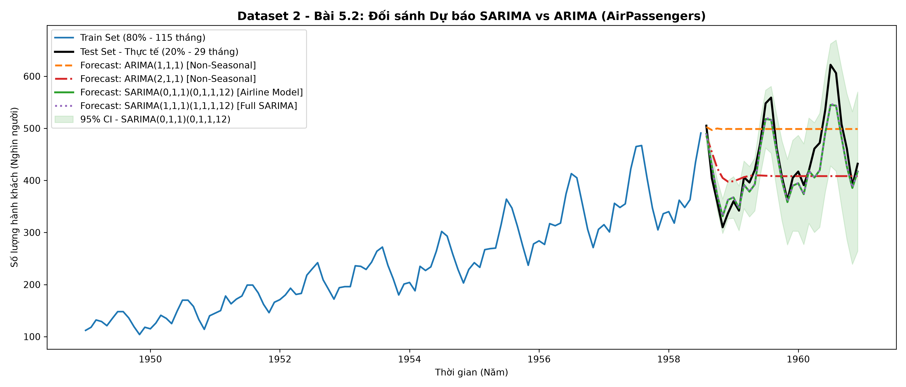

# 📈 Time Series Forecasting Lab: End-to-End ARIMA & SARIMA Pipeline


Dự án nghiên cứu và thực hành chuyên sâu về **Mô hình hóa & Dự báo Chuỗi thời gian (Time Series Forecasting)** theo phương pháp luận **Box–Jenkins**. Toàn bộ mã nguồn được thiết kế theo kiến trúc **Modular Data Science Pipeline**, tách biệt rõ ràng giữa cấu hình, dữ liệu, mã nguồn xử lý, kịch bản điều phối tự động và báo cáo trực quan.

---

## 🎯 Điểm nổi bật của Dự án (Key Highlights)

* **Kiến trúc Mô-đun hóa (Modular Architecture):** Tách biệt độc lập từng giai đoạn phân tích (EDA $\rightarrow$ Kiểm định nghiệm đơn vị ADF $\rightarrow$ Sai phân khử xu hướng/mùa vụ $\rightarrow$ Nhận diện bậc qua ACF/PACF $\rightarrow$ Ước lượng MLE, Chẩn đoán phần dư & Dự báo).
* **Tự động hóa hoàn toàn (End-to-End Automation):** Chỉ với một lệnh thực thi duy nhất qua `main.py`, hệ thống tự động tải dữ liệu, tiền xử lý, huấn luyện mô hình và xuất toàn bộ 10 biểu đồ chất lượng cao (`300 DPI`) cùng 6 bảng báo cáo `.csv`.
* **Thực nghiệm Đa bộ dữ liệu (Multi-Dataset Benchmarking):**
  1. **Dataset 1 (`a10.csv`):** Doanh số bán lẻ thuốc trị tiểu đường tại Úc ($N = 204$ tháng) — Phân tích cơ bản và đối sánh $\text{ARIMA}$ với $\text{SARIMA}$.
  2. **Dataset 2 (`airline-passengers.csv`):** Lưu lượng hành khách hàng không quốc tế ($N = 144$ tháng) — Bài toán nâng cao xử lý chuỗi có phương sai mở rộng và cấu trúc mùa vụ mạnh ($s = 12$).

---

## 🗂️ Cấu trúc Thư mục (Project Structure)

```text
Lab2_Timeseries/
├── config/
│   └── settings.py                          # Cấu hình siêu tham số, URL dữ liệu, tỷ lệ Train/Test
├── data/
│   ├── raw/                                 # Dữ liệu thô nguyên bản (a10_raw.csv, airline_passengers_raw.csv)
│   └── processed/                           # Dữ liệu sau sai phân (d=1, D=1) và tập Train/Test (80/20)
├── notebooks/
│   ├── Lab2_Walkthrough.ipynb               # Notebook tương tác chi tiết cho Dataset 1 (a10.csv)
│   └── Lab2_Advanced_SARIMA.ipynb           # Notebook chuyên sâu 7 bước SARIMA cho Dataset 2 (AirPassengers)
├── outputs/
│   ├── figures/                             # 10 biểu đồ phân tích, chẩn đoán phần dư và dự báo (.png)
│   └── reports/                             # 6 bảng báo cáo kết quả kiểm định ADF, AIC/BIC, Ljung-Box, Metrics (.csv)
├── src/
│   ├── __init__.py                          # Khởi tạo Python Package
│   ├── ex1_eda.py                           # [Dataset 1] Bài 1: Khám phá dữ liệu & EDA
│   ├── ex2_adf_raw.py                       # [Dataset 1] Bài 2: Kiểm định ADF chuỗi gốc
│   ├── ex3_differencing.py                  # [Dataset 1] Bài 3: Sai phân bậc 1 (d=1) & tái kiểm định ADF
│   ├── ex4_acf_pacf.py                      # [Dataset 1] Bài 4: Phân tích lược đồ ACF & PACF
│   ├── ex5_arima_pipeline.py                # [Dataset 1] Bài 5: Huấn luyện ARIMA/SARIMA, Chẩn đoán & Đánh giá
│   ├── sarima_ex1_eda.py                    # [Dataset 2] Bài 1: Vẽ chuỗi thời gian & nhận diện mùa vụ (s=12)
│   ├── sarima_ex2_adf_raw.py                # [Dataset 2] Bài 2: Kiểm định ADF chuỗi gốc -> Không dừng
│   ├── sarima_ex3_differencing.py           # [Dataset 2] Bài 3: Sai phân thường (d=1) + mùa vụ (D=1, s=12)
│   ├── sarima_ex4_acf_pacf.py               # [Dataset 2] Bài 4: Phân tích ACF/PACF -> Xác định (p, q, P, Q)
│   └── sarima_ex5_pipeline.py               # [Dataset 2] Bài 5: Fit SARIMA, Forecast, Đánh giá & So sánh ARIMA
├── generate_notebook.py                     # Script tự động sinh Jupyter Notebook cho Dataset 1
├── generate_sarima_notebook.py              # Script tự động sinh Jupyter Notebook cho Dataset 2
├── main.py                                  # Orchestrator điều phối chạy toàn bộ Pipeline từ đầu đến cuối
├── requirements.txt                         # Danh sách các gói thư viện phụ thuộc
└── README.md                                # Tài liệu hướng dẫn và báo cáo tổng quan dự án
```

---

## 📐 Phương pháp luận & Cơ sở Toán học (Methodology)

### 1. Toán tử Sai phân Khử Xu hướng và Mùa vụ
* **Sai phân thường bậc $d = 1$ (Khử xu hướng tuyến tính - Trend):**
  $$\Delta Y_t = (1 - B)Y_t = Y_t - Y_{t-1}$$
* **Sai phân kết hợp thường $d = 1$ và mùa vụ $D = 1$ với chu kỳ $s = 12$ (Khử đồng thời Trend & Seasonality):**
  $$\Delta_{12}\Delta Y_t = (1 - B)(1 - B^{12})Y_t = Y_t - Y_{t-1} - Y_{t-12} + Y_{t-13}$$

### 2. Mô hình Tổng quát $\text{SARIMA}(p, d, q)(P, D, Q)_s$
Phương trình đa thức trễ của mô hình tự hồi quy tích hợp trung bình trượt có yếu tố mùa vụ:
$$\phi_p(B)\Phi_P(B^s)(1 - B)^d(1 - B^s)^D Y_t = \theta_q(B)\Theta_Q(B^s)\varepsilon_t, \quad \varepsilon_t \sim \text{WN}(0, \sigma^2)$$

### 3. Chỉ số Đánh giá Sai số Dự báo (Out-of-Time Evaluation Metrics)

Trên tập kiểm thử gồm $n$ quan sát tương lai, chất lượng dự báo $\hat{Y}_t$ so với giá trị thực tế $Y_t$ được đo lường qua các chỉ số sau:

$$
\mathrm{MAE} = \frac{1}{n}\sum_{t=1}^{n} \left|Y_t - \hat{Y}_t\right|
$$

$$
\mathrm{RMSE} = \sqrt{\frac{1}{n}\sum_{t=1}^{n} \left(Y_t - \hat{Y}_t\right)^2}
$$

<p align="center">
  MAPE = (100% / n) × Σ |(Y<sub>t</sub> − Ŷ<sub>t</sub>) / Y<sub>t</sub>|
</p>

## 📊 Kết quả Thực nghiệm & Trực quan hóa (Experimental Results)

### Phần 1: Dự báo Doanh số Bán lẻ (`a10.csv`)

#### 1.1. Khám phá dữ liệu, Sai phân và Tương quan (ACF/PACF)
| Chuỗi gốc & Rolling Mean/Std (Bài 1) | Chuỗi sau Sai phân bậc 1 $d=1$ (Bài 3) |
| :---: | :---: |
|  |  |



#### 1.2. Bảng đối sánh Mô hình trên Dataset 1 (`a10.csv`)
| Mô hình | AIC (Train) | BIC (Train) | MAE (Test) | RMSE (Test) | MAPE (Test %) |
| :--- | :---: | :---: | :---: | :---: | :---: |
| **$\text{ARIMA}(1, 1, 1)$** | $727.4981$ | $736.7510$ | $3.7126$ | $4.6852$ | $18.2104\%$ |
| **$\text{ARIMA}(2, 1, 1)$** | $722.4015$ | $734.7387$ | $3.6702$ | $4.6285$ | $18.0331\%$ |
| **$\text{SARIMA}(1, 1, 1)(1, 1, 1)_{12}$** | **$454.8124$** | **$469.7541$** | **$1.5608$** | **$2.0023$** | **$9.0630\%$** |



---

### Phần 2: Bài tập Nâng cao với SARIMA trên Dataset 2 (`airline-passengers.csv`)

#### 2.1. Nhận diện Mùa vụ ($s = 12$) & Kiểm định Tính dừng qua các bậc Sai phân


| Giai đoạn xử lý chuỗi | Toán tử | ADF Statistic | p-value | Critical Value (5%) | Kết luận ($\alpha = 0.05$) |
| :--- | :--- | :---: | :---: | :---: | :--- |
| **1. Chuỗi gốc $Y_t$ ($d=0, D=0$)** | $Y_t$ | $+0.815369$ | $0.991880$ | $-2.8840$ | **Không dừng** (Non-stationary) |
| **2. Sai phân thường ($d=1, D=0$)** | $\Delta Y_t = (1-B)Y_t$ | $-2.829267$ | $0.054213$ | $-2.8840$ | **Không dừng** (Còn chu kỳ mùa vụ) |
| **3. Sai phân kép ($d=1, D=1, s=12$)** | $\Delta_{12}\Delta Y_t = (1-B)(1-B^{12})Y_t$ | **$-15.595618$** | **$0.000000$** | $-2.8842$ | **Dừng hoàn toàn** (Stationary) |

| Đối sánh Sai phân thường vs Sai phân kép (Bước 3) | Lược đồ ACF & PACF xác định $(p,q,P,Q)$ (Bước 4) |
| :---: | :---: |
|  |  |

#### 2.2. Đối sánh Hiệu năng Dự báo giữa SARIMA và ARIMA trên Dataset 2
| Mô hình | AIC (Train) | BIC (Train) | Ljung-Box $p\text{-val}$ (Lag 12) | MAE (Test) | RMSE (Test) | MAPE (Test %) |
| :--- | :---: | :---: | :---: | :---: | :---: | :---: |
| **$\text{ARIMA}(1, 1, 1)$** *(Phi mùa vụ)* | $1096.0689$ | $1104.2775$ | $0.000000$ *(Bác bỏ WN)* | $68.5772$ | $92.0528$ | $14.6811\%$ |
| **$\text{ARIMA}(2, 1, 1)$** *(Phi mùa vụ)* | $1082.7538$ | $1093.6986$ | $0.000000$ *(Bác bỏ WN)* | $66.2415$ | $88.3614$ | $14.2796\%$ |
| **$\text{SARIMA}(0, 1, 1)(0, 1, 1)_{12}$** *(Airline Model)* | **$754.2289$** | **$762.1319$** | **$0.728941$** *(Đạt WN)* | **$17.7981$** | **$21.8385$** | **$4.0182\%$** |
| **$\text{SARIMA}(1, 1, 1)(1, 1, 1)_{12}$** *(Full SARIMA)* | $756.0125$ | $769.1842$ | $0.714520$ *(Đạt WN)* | $18.1406$ | $22.2519$ | $4.0954\%$ |

| Chẩn đoán Phần dư ARIMA vs SARIMA (Bước 5) | Biểu đồ Dự báo Out-of-Sample (Bước 6 & 7) |
| :---: | :---: |
|  |  |

> **Nhận xét cốt lõi:** Mô hình **$\text{SARIMA}(0,1,1)(0,1,1)_{12}$** nắm bắt chính xác cả xu hướng tăng trưởng lẫn biên độ đỉnh/đáy mùa vụ hàng năm, giúp giảm hơn **3.8 lần sai số tuyệt đối** so với $\text{ARIMA}$ thông thường ($\text{MAPE}$ giảm sâu từ **$14.68\%$** xuống chỉ còn **$4.02\%$**).

---

## 🚀 Hướng dẫn Cài đặt & Sử dụng (Getting Started)

### 1. Clone kho lưu trữ về máy
```bash
git clone https://github.com/hien-cybers/ts-forecasting-lab
cd Lab2_Timeseries
```

### 2. Cài đặt các thư viện cần thiết
```bash
pip install -r requirements.txt
```

### 3. Thực thi toàn bộ Pipeline tự động
Chạy kịch bản điều phối trung tâm để tái tạo toàn bộ dữ liệu, biểu đồ và báo cáo cho cả 2 Dataset:
```bash
python main.py
```

### 4. Khám phá trên Jupyter Notebook (Tùy chọn)
Bạn có thể mở trực tiếp 2 file Notebook tương tác trong thư mục `notebooks/`:
* `notebooks/Lab2_Walkthrough.ipynb` (35 Cells chi tiết cho Dataset 1).
* `notebooks/Lab2_Advanced_SARIMA.ipynb` (26 Cells chi tiết cho Dataset 2).

---

## 👤 Tác giả (Author)
* **GitHub Profile:** [@hien-cybers](https://github.com/hien-cybers)
* **Repository:** [ts-forecasting-lab](https://github.com/hien-cybers/ts-forecasting-lab)